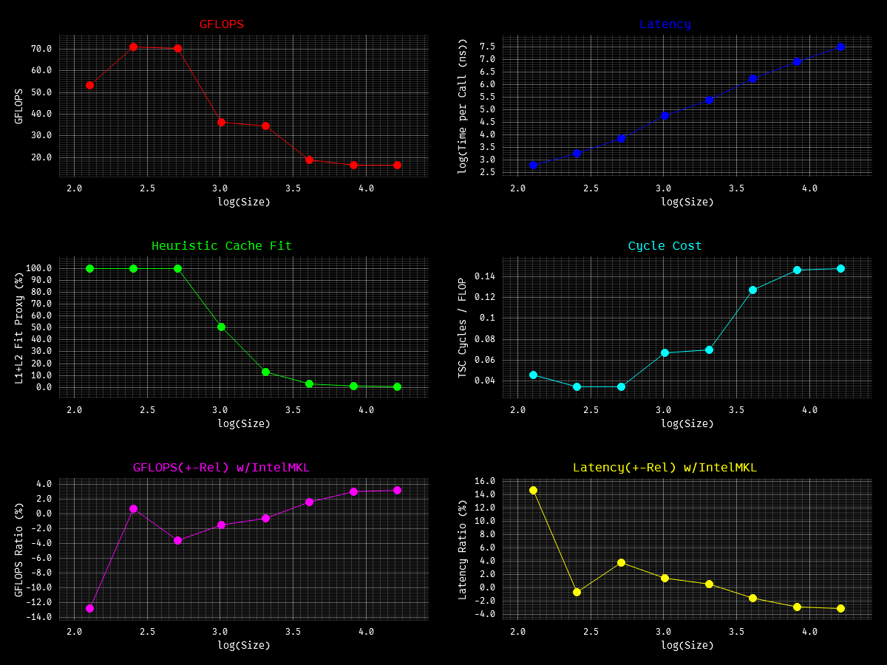
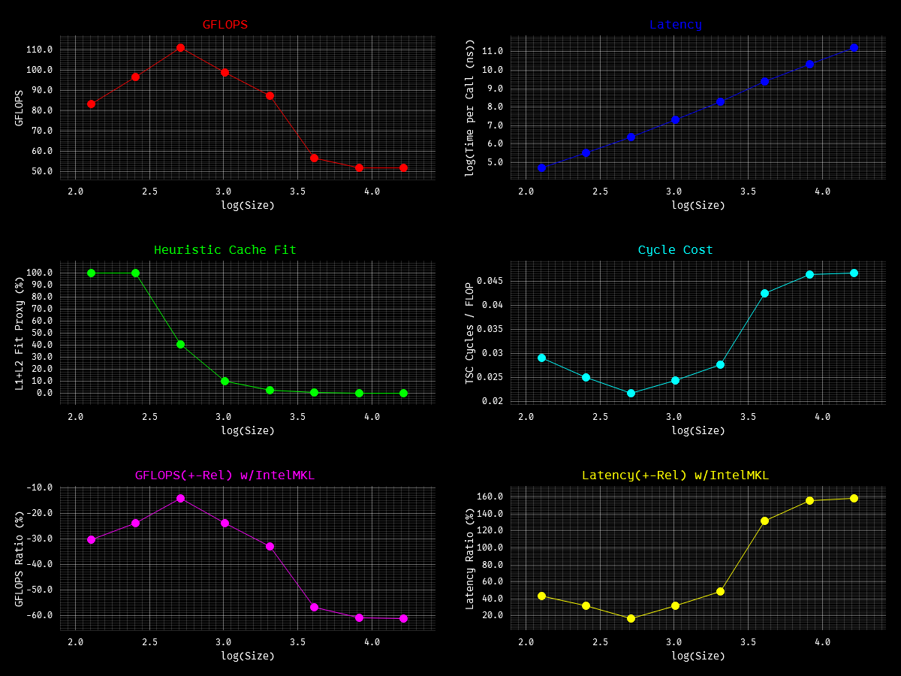

**BLAS FORTRAN 77** and **Intel Math Library** Kernels in modern native rust. `ONLY x86_64`

[Bench ref](https://github.com/OpenMathLib/OpenBLAS/tree/develop/benchmark)
To bench, run **[main harness](bench/main.rs)** using
`cargo bench --bench main -- --kernels <kernel1> <kernel2> ...` (e.g.
`--kernels axpy dot`) or the **[lite harness](bench/lite.rs)** using
`cargo bench --bench lite -- <kernel> <size> [time_secs]` (e.g.
`axpy 2048 12`).
Build using `RUSTFLAGS target-cpu=x86-64-v3` (already set in `.cargo/config.toml`), otherwise rustc will throw error.
Use `Intel Vtune/Advisor` with lite harness for profiling and better understanding, since lite harness has less noise
and overhead.

Install [Intel oneAPI Toolkit](https://www.intel.com/content/www/us/en/developer/tools/oneapi/oneapi-toolkit-download.html?packages=oneapi-toolkit&oneapi-toolkit-os=linux&oneapi-lin=offline)
then copy the `.dll` or `.so` into the project root:

- windows > `Copy-Item "C:\Program Files (x86)\Intel\oneAPI\compiler\2026.2\bin\libiomp5md.dll" .`
- linux > `cp /home/ronakgh97/intel/oneapi/compiler/latest/lib/libiomp5.so .`
- mac > `sell that bullshit`

> All are single threaded, ran on i7 14650hx, rust 1.99.1, last updated on 08/20/2026

**AXPY**

| Size  | Run      | GFLOPS  | %GFLOPS   | %Latency  | WSS Cache | Cyc/Flop |
|-------|----------|---------|-----------|-----------|-----------|----------|
| 128   | 89941057 | 7.3291  | +29.1142% | -22.5492% | 100.00%   | 0.3301   |
| 256   | 82070072 | 13.3753 | +4.1257%  | -3.9622%  | 100.00%   | 0.1809   |
| 512   | 68915958 | 22.4631 | -5.6405%  | +5.9776%  | 100.00%   | 0.1077   |
| 1024  | 52078382 | 33.9498 | -1.0246%  | +1.0352%  | 100.00%   | 0.0713   |
| 2048  | 25760351 | 33.5863 | -33.9609% | +51.4254% | 100.00%   | 0.0720   |
| 4096  | 14141593 | 36.8755 | -40.8994% | +69.2029% | 100.00%   | 0.0656   |
| 8192  | 4862441  | 25.3585 | -12.0057% | +13.6437% | 100.00%   | 0.0954   |
| 16384 | 2366736  | 24.6859 | -12.4315% | +14.1964% | 100.00%   | 0.0980   |

**DOT**

| Size  | Run      | GFLOPS   | %GFLOPS    | %Latency  | WSS Cache | Cyc/Flop |
|-------|----------|----------|------------|-----------|-----------|----------|
| 128   | 97172315 | 7.9183   | +15.9379%  | -13.7470% | 100.00%   | 0.3055   |
| 256   | 95571482 | 15.5757  | +22.4039%  | -18.3033% | 100.00%   | 0.1553   |
| 512   | 93504124 | 30.4776  | +36.4360%  | -26.7056% | 100.00%   | 0.0794   |
| 1024  | 88822557 | 57.9033  | +84.5812%  | -45.8233% | 100.00%   | 0.0418   |
| 2048  | 80421242 | 104.8530 | +120.6582% | -54.6810% | 100.00%   | 0.0231   |
| 4096  | 65436982 | 170.6328 | +253.0534% | -71.6757% | 100.00%   | 0.0142   |
| 8192  | 46110922 | 240.4772 | +761.8483% | -88.3970% | 100.00%   | 0.0101   |
| 16384 | 28966702 | 302.1336 | +796.8964% | -88.8504% | 100.00%   | 0.0080   |

**NRM2**

| Size  | Run      | GFLOPS  | %GFLOPS   | %Latency  | WSS Cache | Cyc/Flop |
|-------|----------|---------|-----------|-----------|-----------|----------|
| 128   | 66938310 | 5.4546  | -11.0731% | +12.4519% | 100.00%   | 0.4435   |
| 256   | 56053691 | 9.1353  | -11.9821% | +13.6132% | 100.00%   | 0.2648   |
| 512   | 43465719 | 14.1676 | -7.2357%  | +7.8001%  | 100.00%   | 0.1708   |
| 1024  | 31375086 | 20.4534 | -2.8502%  | +2.9338%  | 100.00%   | 0.1183   |
| 2048  | 19249666 | 25.0977 | -3.2627%  | +3.3727%  | 100.00%   | 0.0964   |
| 4096  | 11287349 | 29.4318 | +0.1733%  | -0.1730%  | 100.00%   | 0.0822   |
| 8192  | 6124933  | 31.9427 | +1.2032%  | -1.1889%  | 100.00%   | 0.0757   |
| 16384 | 2995423  | 31.2434 | -2.2605%  | +2.3128%  | 100.00%   | 0.0774   |

**ASUM**

| Size  | Run      | GFLOPS  | %GFLOPS  | %Latency  | WSS Cache | Cyc/Flop |
|-------|----------|---------|----------|-----------|-----------|----------|
| 128   | 92492200 | 3.7685  | +9.1669% | -8.3971%  | 100.00%   | 0.6420   |
| 256   | 87042042 | 7.0928  | +5.0169% | -4.7772%  | 100.00%   | 0.3411   |
| 512   | 78961025 | 12.8686 | +1.6656% | -1.6383%  | 100.00%   | 0.1880   |
| 1024  | 62147836 | 20.2570 | -0.4838% | +0.4861%  | 100.00%   | 0.1194   |
| 2048  | 42454010 | 27.6757 | -4.9534% | +5.2115%  | 100.00%   | 0.0874   |
| 4096  | 26360601 | 34.3689 | -6.1872% | +6.5953%  | 100.00%   | 0.0704   |
| 8192  | 14624152 | 38.1339 | -8.4910% | +9.2788%  | 100.00%   | 0.0634   |
| 16384 | 4549961  | 23.7289 | -9.1763% | +10.1034% | 100.00%   | 0.1020   |

**I_AMAX**

| Size  | Run      | GFLOPS  | %GFLOPS    | %Latency   | WSS Cache | Cyc/Flop |
|-------|----------|---------|------------|------------|-----------|----------|
| 128   | 68842003 | 2.8049  | +108.5877% | -52.0585%  | 100.00%   | 0.8625   |
| 256   | 55157903 | 4.4947  | +69.1388%  | -40.8769%  | 100.00%   | 0.5382   |
| 512   | 40548789 | 6.6084  | -3.9130%   | +4.0723%   | 100.00%   | 0.3661   |
| 1024  | 25117705 | 8.1871  | -30.0589%  | +42.9775%  | 100.00%   | 0.2955   |
| 2048  | 14790796 | 9.6421  | -47.6016%  | +90.8455%  | 100.00%   | 0.2509   |
| 4096  | 7769712  | 10.1301 | -61.2189%  | +157.8577% | 100.00%   | 0.2388   |
| 8192  | 4078681  | 10.6355 | -66.2962%  | +196.7024% | 100.00%   | 0.2275   |
| 16384 | 2088511  | 10.8920 | -61.8741%  | +162.2888% | 100.00%   | 0.2221   |

**GEMV**

| Size  | Run     | GFLOPS  | %GFLOPS   | %Latency  | WSS Cache | Cyc/Flop |
|-------|---------|---------|-----------|-----------|-----------|----------|
| 128   | 3241362 | 53.1001 | -12.8399% | +14.7314% | 100.00%   | 0.0456   |
| 256   | 1084617 | 71.0814 | +0.6962%  | -0.6914%  | 100.00%   | 0.0340   |
| 512   | 268098  | 70.2802 | -3.6030%  | +3.7377%  | 100.00%   | 0.0344   |
| 1024  | 34432   | 36.1040 | -1.4569%  | +1.4785%  | 51.02%    | 0.0670   |
| 2048  | 8257    | 34.6324 | -0.5891%  | +0.5926%  | 12.77%    | 0.0699   |
| 4096  | 1132    | 18.9895 | +1.6010%  | -1.5758%  | 3.20%     | 0.1274   |
| 8192  | 247     | 16.5505 | +2.9944%  | -2.9073%  | 0.80%     | 0.1462   |
| 16384 | 61      | 16.3223 | +3.2493%  | -3.1471%  | 0.20%     | 0.1482   |

**GEMV_T**

| Size  | Run     | GFLOPS  | %GFLOPS  | %Latency | WSS Cache | Cyc/Flop |
|-------|---------|---------|----------|----------|-----------|----------|
| 128   | 4248004 | 69.5993 | +8.3940% | -7.7440% | 100.00%   | 0.0348   |
| 256   | 1127538 | 73.8943 | +3.6890% | -3.5578% | 100.00%   | 0.0327   |
| 512   | 277109  | 72.6423 | +1.1904% | -1.1764% | 100.00%   | 0.0333   |
| 1024  | 33823   | 35.4653 | -4.1473% | +4.3268% | 51.02%    | 0.0682   |
| 2048  | 8617    | 36.1379 | +3.3661% | -3.2565% | 12.77%    | 0.0669   |
| 4096  | 1150    | 19.2773 | -0.3482% | +0.3495% | 3.20%     | 0.1255   |
| 8192  | 242     | 16.1827 | -0.6822% | +0.6868% | 0.80%     | 0.1495   |
| 16384 | 61      | 16.2154 | -0.6713% | +0.6759% | 0.20%     | 0.1492   |

**GEMM_F_F**

| Size  | Run   | GFLOPS   | %GFLOPS   | %Latency   | WSS Cache | Cyc/Flop |
|-------|-------|----------|-----------|------------|-----------|----------|
| 128   | 39717 | 83.2920  | -30.2797% | +43.4303%  | 100.00%   | 0.0290   |
| 256   | 5760  | 96.6350  | -23.8780% | +31.3680%  | 100.00%   | 0.0250   |
| 512   | 831   | 111.4461 | -14.0646% | +16.3665%  | 40.94%    | 0.0217   |
| 1024  | 93    | 98.9104  | -23.8761% | +31.3648%  | 10.23%    | 0.0245   |
| 2048  | 11    | 87.4882  | -32.8669% | +48.9577%  | 2.56%     | 0.0277   |
| 4096  | 1     | 56.8975  | -56.9288% | +132.1735% | 0.64%     | 0.0425   |
| 8192  | 1     | 52.1073  | -60.8331% | +155.3175% | 0.16%     | 0.0464   |
| 16384 | 1     | 51.7685  | -61.3525% | +158.7488% | 0.04%     | 0.0467   |

Want to improve the bench or fix nasty numeric edge cases? Send some PRs.

---

References I took:

- https://www.netlib.org/blas/ ← good for overview
- https://www.netlib.org/lapack/explore-html/ ←/
- https://icl.utk.edu/~mgates3/docs/lapack.html ←/
- https://suif.stanford.edu/papers/lam-asplos91.pdf  <- good for understanding cache blocking techniques & optimizations
- https://www.intel.com/content/www/us/en/docs/onemkl/developer-reference-dpcpp/2025-2/blas-routines.html ← good
  details, very clear
- https://www.intel.com/content/www/us/en/docs/intrinsics-guide/index.html ← intel man for intrinsics
- https://doc.rust-lang.org/core/arch/x86_64/index.html#functions ←/
- https://public.dhe.ibm.com/software/dw/cell/BLAS_Prog_Guide_API_v3.1.pdf <- api ref, mostly similar everywhere

TODO:

- lvl1: rotmg, rotm
- lvl2: gemv - all
- lvl3: gemm - all
- handle NaN, over/underflow, return vs panic and many more edge cases :(
- multithreading, GPU maybe (NOT CUDA)?
- LESS BAD BRANCHING, more SIMD, LESS FN CALLS, better DATA_READ, better CACHE
- MAKE GEMV & GEMM FAST FOR ALL PATHS!!!
- bench is somewhat UNFAIR AND NOT UNIFORM
