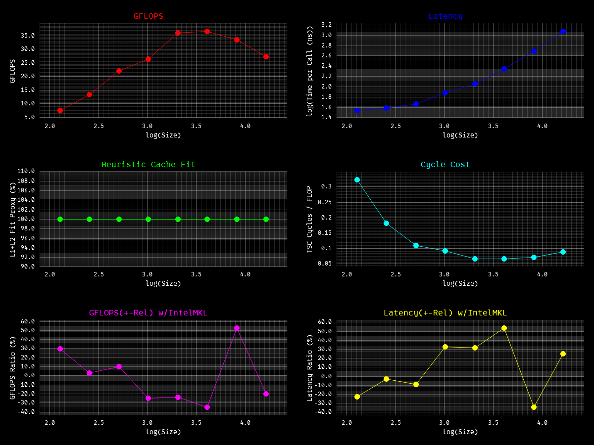
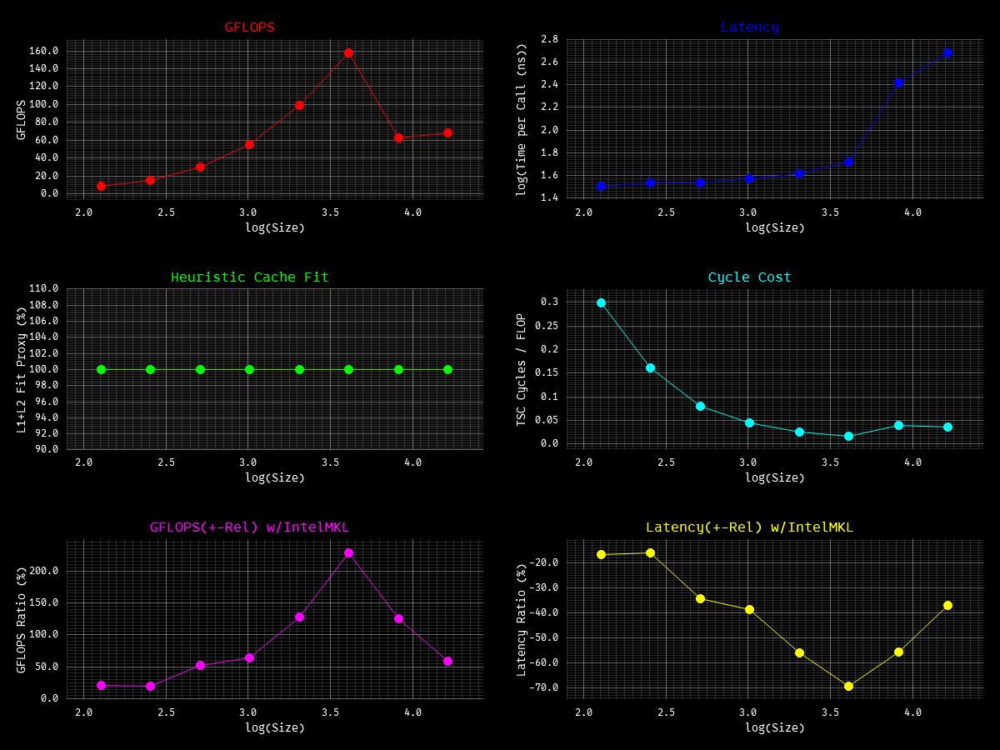
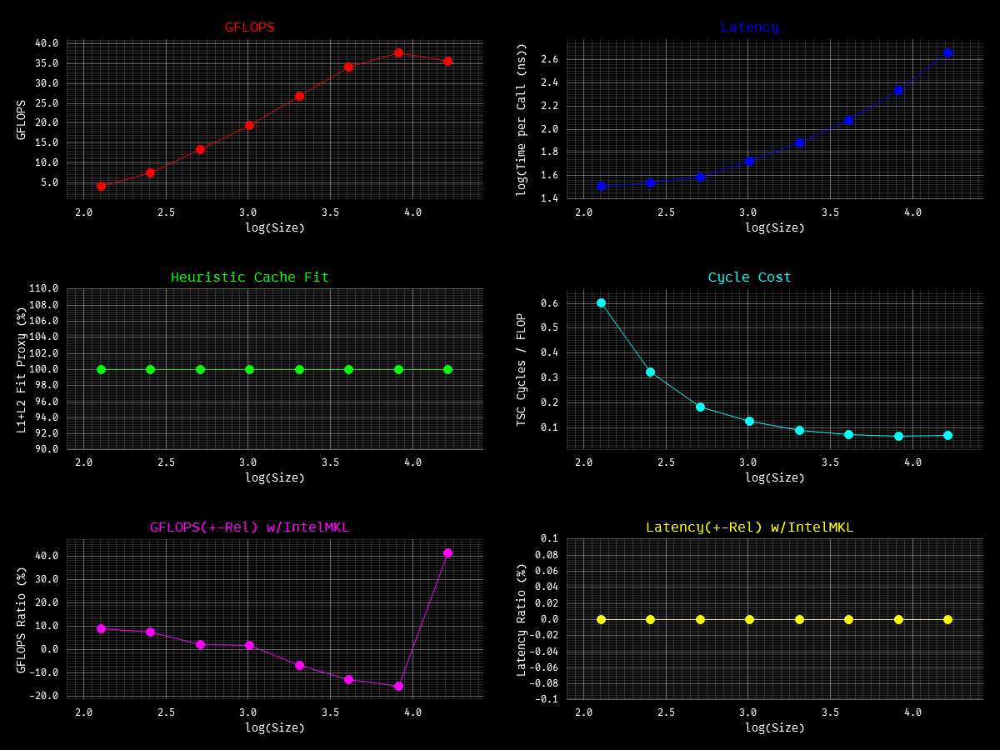
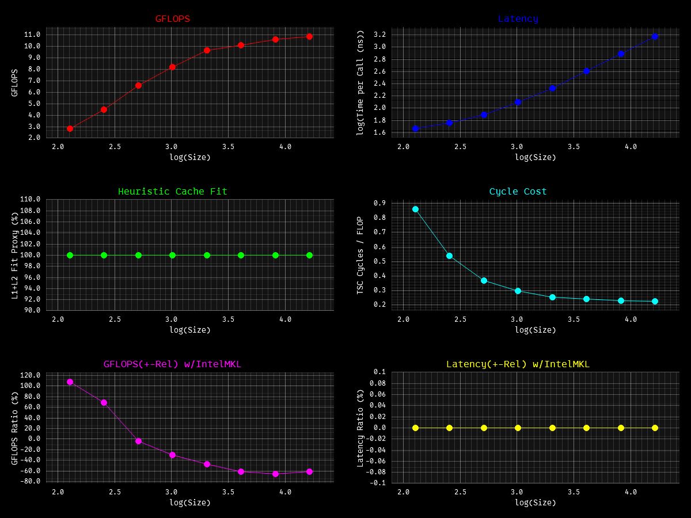
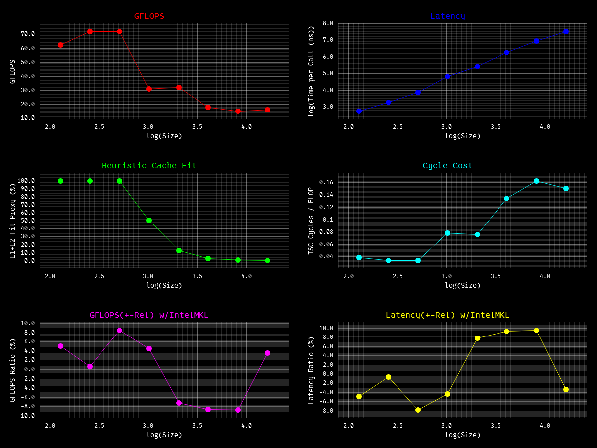
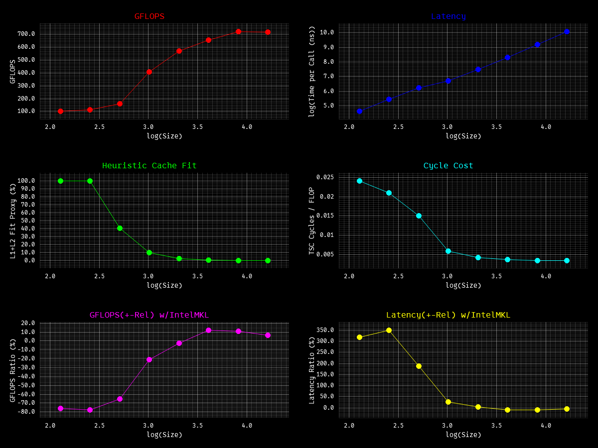

**BLAS Kernels** and **Intel Math Library** Kernels in modern native RUST 🦀. `ONLY x86_64`

To bench, run **[main harness](bench/main.rs)** using
`cargo bench --bench main -- --kernels <kernel1> <kernel2> ...` (e.g.
`--kernels axpy dot`) or the **[lite harness](bench/lite.rs)** using
`cargo bench --bench lite -- <kernel> <size> [time_secs]` (e.g.
`axpy 2048 12`).
Build using `RUSTFLAGS target-cpu=x86-64-v3` (already set in `.cargo/config.toml`), otherwise rustc will throw error.
Use `Intel Vtune/Advisor` with lite harness for better profiling and insights, since lite harness has less noise
and overhead. [Bench reference here](https://github.com/OpenMathLib/OpenBLAS/tree/develop/benchmark)

Install [Intel oneAPI Toolkit](https://www.intel.com/content/www/us/en/developer/tools/oneapi/oneapi-toolkit-download.html?packages=oneapi-toolkit&oneapi-toolkit-os=linux&oneapi-lin=offline)
then copy the `.dll` or `.so` into the project root:

- windows > `Copy-Item "C:\Program Files (x86)\Intel\oneAPI\compiler\2026.2\bin\libiomp5md.dll" .`
- linux > `cp /home/ronakgh97/intel/oneapi/compiler/latest/lib/libiomp5.so .`
- mac > `sell that shit pls` 😭🙏

> All are single threaded except GEMM (8 threads), ran on i7 14650hx, rust 1.100.0, last updated on 11/13/2026

**AXPY**

| Size  | Run      | GFLOPS  | %GFLOPS   | %Latency  | WSS Cache | Cyc/Flop |
|-------|----------|---------|-----------|-----------|-----------|----------|
| 128   | 89941057 | 7.3291  | +29.1142% | -22.5492% | 100.00%   | 0.3301   |
| 256   | 82070072 | 13.3753 | +4.1257%  | -3.9622%  | 100.00%   | 0.1809   |
| 512   | 68915958 | 22.4631 | -5.6405%  | +5.9776%  | 100.00%   | 0.1077   |
| 1024  | 52078382 | 33.9498 | -1.0246%  | +1.0352%  | 100.00%   | 0.0713   |
| 2048  | 25760351 | 33.5863 | -33.9609% | +51.4254% | 100.00%   | 0.0720   |
| 4096  | 14141593 | 36.8755 | -40.8994% | +69.2029% | 100.00%   | 0.0656   |
| 8192  | 4862441  | 25.3585 | -12.0057% | +13.6437% | 100.00%   | 0.0954   |
| 16384 | 2366736  | 24.6859 | -12.4315% | +14.1964% | 100.00%   | 0.0980   |

**DOT**

| Size  | Run      | GFLOPS   | %GFLOPS    | %Latency  | WSS Cache | Cyc/Flop |
|-------|----------|----------|------------|-----------|-----------|----------|
| 128   | 97172315 | 7.9183   | +15.9379%  | -13.7470% | 100.00%   | 0.3055   |
| 256   | 95571482 | 15.5757  | +22.4039%  | -18.3033% | 100.00%   | 0.1553   |
| 512   | 93504124 | 30.4776  | +36.4360%  | -26.7056% | 100.00%   | 0.0794   |
| 1024  | 88822557 | 57.9033  | +84.5812%  | -45.8233% | 100.00%   | 0.0418   |
| 2048  | 80421242 | 104.8530 | +120.6582% | -54.6810% | 100.00%   | 0.0231   |
| 4096  | 65436982 | 170.6328 | +253.0534% | -71.6757% | 100.00%   | 0.0142   |
| 8192  | 46110922 | 240.4772 | +761.8483% | -88.3970% | 100.00%   | 0.0101   |
| 16384 | 28966702 | 302.1336 | +796.8964% | -88.8504% | 100.00%   | 0.0080   |

**NRM2**

| Size  | Run      | GFLOPS  | %GFLOPS   | %Latency  | WSS Cache | Cyc/Flop |
|-------|----------|---------|-----------|-----------|-----------|----------|
| 128   | 65838904 | 5.3650  | -10.3183% | +11.5055% | 100.00%   | 0.4509   |
| 256   | 55689023 | 9.0759  | -12.7973% | +14.6753% | 100.00%   | 0.2666   |
| 512   | 42895894 | 13.9819 | -6.4494%  | +6.8940%  | 100.00%   | 0.1730   |
| 1024  | 30399118 | 19.8171 | -3.5199%  | +3.6484%  | 100.00%   | 0.1221   |
| 2048  | 18663431 | 24.3333 | -1.6706%  | +1.6990%  | 100.00%   | 0.0994   |
| 4096  | 11199724 | 29.2043 | +0.8402%  | -0.8332%  | 100.00%   | 0.0828   |
| 8192  | 5796950  | 30.2322 | -3.0774%  | +3.1751%  | 100.00%   | 0.0800   |
| 16384 | 2304543  | 24.0372 | -27.5569% | +38.0394% | 100.00%   | 0.1006   |

**ASUM**

| Size  | Run      | GFLOPS  | %GFLOPS   | %Latency  | WSS Cache | Cyc/Flop |
|-------|----------|---------|-----------|-----------|-----------|----------|
| 128   | 88820051 | 3.6188  | +9.1883%  | -8.4151%  | 100.00%   | 0.6685   |
| 256   | 80535955 | 6.5627  | -0.9141%  | +0.9226%  | 100.00%   | 0.3686   |
| 512   | 74749499 | 12.1823 | -0.0164%  | +0.0164%  | 100.00%   | 0.1986   |
| 1024  | 56811266 | 18.5176 | +0.2123%  | -0.2119%  | 100.00%   | 0.1306   |
| 2048  | 40081582 | 26.1291 | -6.4639%  | +6.9106%  | 100.00%   | 0.0926   |
| 4096  | 25003765 | 32.5998 | -8.1022%  | +8.8165%  | 100.00%   | 0.0742   |
| 8192  | 14274196 | 37.2213 | -7.1366%  | +7.6850%  | 100.00%   | 0.0650   |
| 16384 | 5373019  | 28.0213 | +12.6329% | -11.2160% | 100.00%   | 0.0863   |

**I_AMAX**

| Size  | Run      | GFLOPS  | %GFLOPS    | %Latency   | WSS Cache | Cyc/Flop |
|-------|----------|---------|------------|------------|-----------|----------|
| 128   | 68842003 | 2.8049  | +108.5877% | -52.0585%  | 100.00%   | 0.8625   |
| 256   | 55157903 | 4.4947  | +69.1388%  | -40.8769%  | 100.00%   | 0.5382   |
| 512   | 40548789 | 6.6084  | -3.9130%   | +4.0723%   | 100.00%   | 0.3661   |
| 1024  | 25117705 | 8.1871  | -30.0589%  | +42.9775%  | 100.00%   | 0.2955   |
| 2048  | 14790796 | 9.6421  | -47.6016%  | +90.8455%  | 100.00%   | 0.2509   |
| 4096  | 7769712  | 10.1301 | -61.2189%  | +157.8577% | 100.00%   | 0.2388   |
| 8192  | 4078681  | 10.6355 | -66.2962%  | +196.7024% | 100.00%   | 0.2275   |
| 16384 | 2088511  | 10.8920 | -61.8741%  | +162.2888% | 100.00%   | 0.2221   |

**GEMV_N**

| Size  | Run     | GFLOPS  | %GFLOPS  | %Latency | WSS Cache | Cyc/Flop |
|-------|---------|---------|----------|----------|-----------|----------|
| 128   | 4454890 | 46.4662 | +9.9644% | -9.0615% | 100.00%   | 0.0521   |
| 256   | 1067249 | 44.5272 | -1.5758% | +1.6010% | 100.00%   | 0.0543   |
| 512   | 396253  | 66.1290 | +0.3655% | -0.3641% | 100.00%   | 0.0366   |
| 1024  | 50608   | 33.7830 | -1.6332% | +1.6603% | 51.02%    | 0.0716   |
| 2048  | 11879   | 31.7177 | +5.4792% | -5.1946% | 12.77%    | 0.0763   |
| 4096  | 1628    | 17.3792 | -7.4071% | +7.9996% | 3.20%     | 0.1392   |
| 8192  | 383     | 16.3561 | +2.9427% | -2.8586% | 0.80%     | 0.1479   |
| 16384 | 91      | 15.3915 | -1.4155% | +1.4359% | 0.20%     | 0.1572   |

**GEMV_T**

| Size  | Run     | GFLOPS  | %GFLOPS  | %Latency | WSS Cache | Cyc/Flop |
|-------|---------|---------|----------|----------|-----------|----------|
| 128   | 5979775 | 62.3713 | +5.1099% | -4.8615% | 100.00%   | 0.0388   |
| 256   | 1720287 | 71.7730 | +0.6264% | -0.6225% | 100.00%   | 0.0337   |
| 512   | 431959  | 72.0879 | +8.5521% | -7.8783% | 100.00%   | 0.0336   |
| 1024  | 46185   | 30.8299 | +4.4978% | -4.3042% | 51.02%    | 0.0785   |
| 2048  | 11971   | 31.9634 | -7.2392% | +7.8042% | 12.77%    | 0.0757   |
| 4096  | 1686    | 18.0030 | -8.5826% | +9.3884% | 3.20%     | 0.1344   |
| 8192  | 348     | 14.8419 | -8.7660% | +9.6083% | 0.80%     | 0.1630   |
| 16384 | 94      | 16.0522 | +3.5400% | -3.4190% | 0.20%     | 0.1507   |

**GEMM_N_N**

| Size  | Run   | GFLOPS   | %GFLOPS   | %Latency    | WSS Cache | Cyc/Flop |
|-------|-------|----------|-----------|-------------|-----------|----------|
| 128   | 22800 | 30.4400  | -92.8007% | +1289.0269% | 100.00%   | 0.0795   |
| 256   | 11096 | 118.5071 | -79.5343% | +388.6222%  | 100.00%   | 0.0204   |
| 512   | 2617  | 223.6025 | -64.0760% | +178.3655%  | 80.62%    | 0.0108   |
| 1024  | 858   | 586.4814 | -8.1842%  | +8.9137%    | 20.16%    | 0.0041   |
| 2048  | 138   | 754.5034 | +10.1206% | -9.1905%    | 5.04%     | 0.0032   |
| 4096  | 20    | 836.2959 | +23.7511% | -19.1927%   | 1.26%     | 0.0029   |
| 8192  | 3     | 870.0962 | +13.6947% | -12.0451%   | 0.31%     | 0.0028   |
| 16384 | 1     | 881.1128 | +13.6526% | -12.0125%   | 0.08%     | 0.0027   |

**GEMM_T_N**

| Size  | Run   | GFLOPS   | %GFLOPS   | %Latency    | WSS Cache | Cyc/Flop |
|-------|-------|----------|-----------|-------------|-----------|----------|
| 128   | 19656 | 26.2422  | -92.3771% | +1211.8289% | 100.00%   | 0.0922   |
| 256   | 6726  | 71.8284  | -85.9502% | +611.7550%  | 100.00%   | 0.0337   |
| 512   | 2014  | 172.0473 | -60.7803% | +154.9738%  | 80.62%    | 0.0141   |
| 1024  | 604   | 412.5559 | -20.8702% | +26.3746%   | 20.16%    | 0.0059   |
| 2048  | 105   | 573.9938 | -2.5861%  | +2.6547%    | 5.04%     | 0.0042   |
| 4096  | 16    | 664.8697 | +13.0921% | -11.5765%   | 1.26%     | 0.0036   |
| 8192  | 2     | 694.2162 | +4.3992%  | -4.2138%    | 0.31%     | 0.0035   |
| 16384 | 1     | 750.1939 | +11.2941% | -10.1480%   | 0.08%     | 0.0032   |

Want to improve the bench perf or fix nasty numeric edge cases? Send some PRs.

---

References I took:

- https://www.netlib.org/blas/ ← good for overview
- https://www.netlib.org/lapack/explore-html/ ←/
- https://icl.utk.edu/~mgates3/docs/lapack.html ←/
- https://suif.stanford.edu/papers/lam-asplos91.pdf  <- good for understanding cache blocking techniques & optimizations
- https://www.intel.com/content/www/us/en/docs/onemkl/developer-reference-dpcpp/2025-2/blas-routines.html ← good
  details, very clear
- https://www.intel.com/content/www/us/en/docs/intrinsics-guide/index.html ← intel man for intrinsics
- https://doc.rust-lang.org/core/arch/x86_64/index.html#functions ←/
- https://public.dhe.ibm.com/software/dw/cell/BLAS_Prog_Guide_API_v3.1.pdf <- api ref, mostly similar everywhere

TODO:

- lvl1: rotmg and rotm kernel
- lvl2: gemv - all
- lvl3: gemm - all
- handle NaN, over/underflow, return vs panic and many more edge cases :(
- multithreading, GPU maybe (NOT CUDA)?
- LESS BAD BRANCHING, more SIMD, LESS FN CALLS, better DATA_READ, better CACHE
- MAKE GEMV & GEMM FAST FOR ALL PATHS!!!
- bench is somewhat UNFAIR AND NOT UNIFORM
