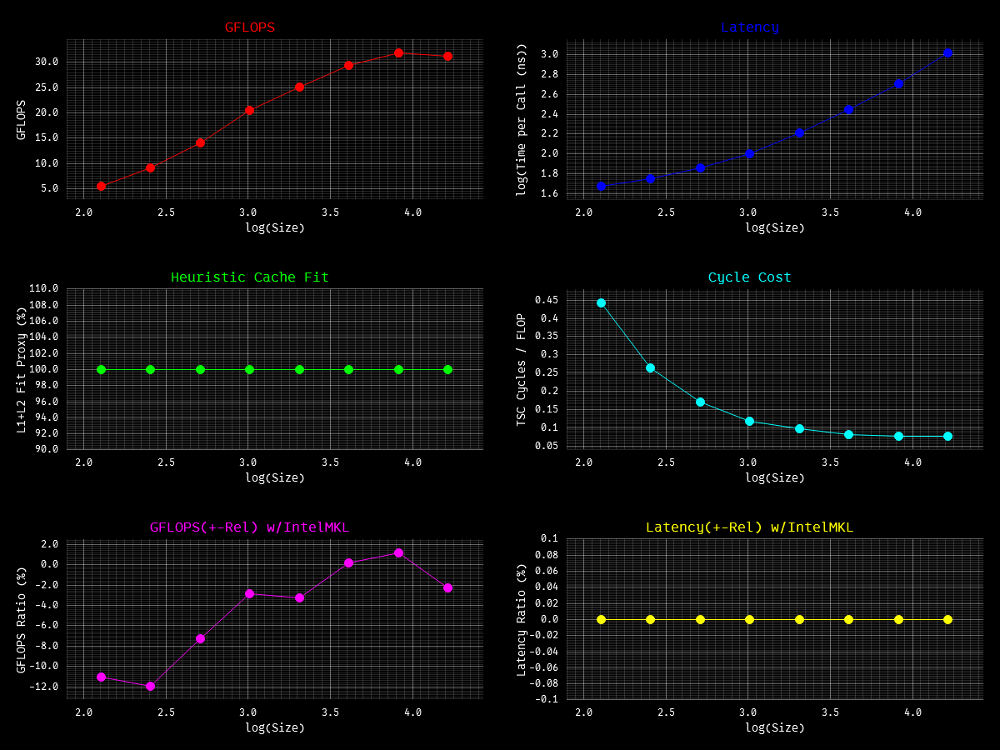
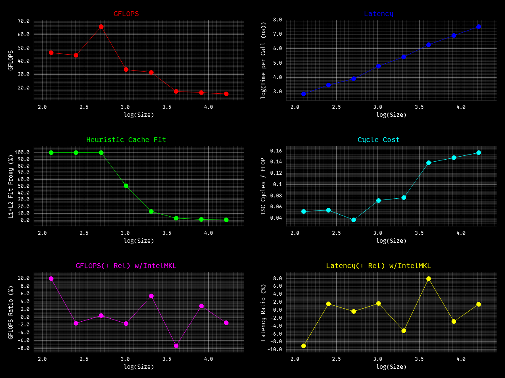
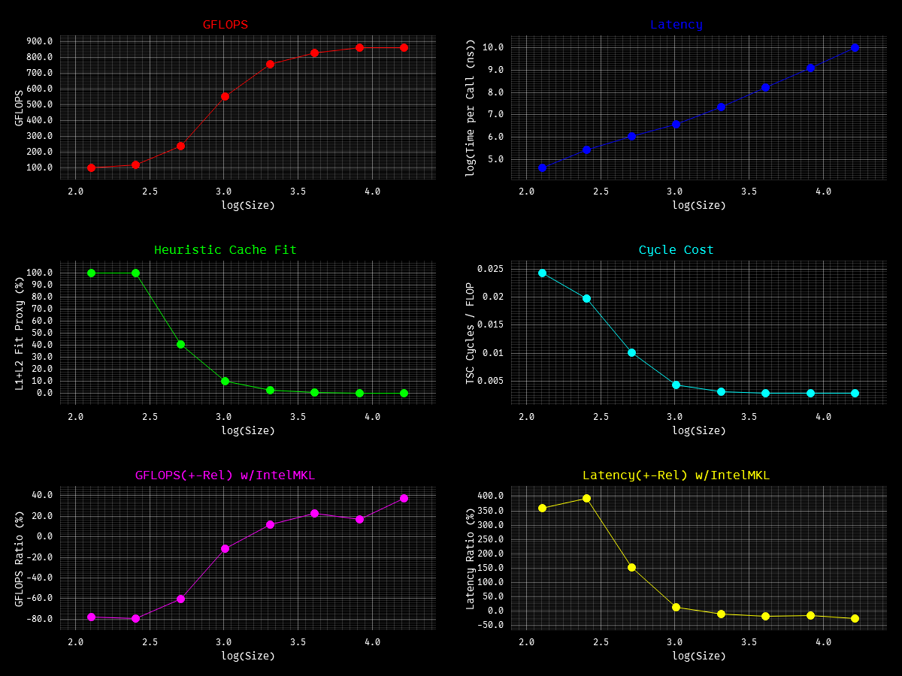

**BLAS Kernels** and **Intel Math Library** Kernels in modern native RUST 🦀. `ONLY x86_64`

To bench, run **[main harness](bench/main.rs)** using
`cargo bench --bench main -- --kernels <kernel1> <kernel2> ...` (e.g.
`--kernels axpy dot`) or the **[lite harness](bench/lite.rs)** using
`cargo bench --bench lite -- <kernel> <size> [time_secs]` (e.g.
`axpy 2048 12`).
Build using `RUSTFLAGS target-cpu=x86-64-v3` (already set in `.cargo/config.toml`), otherwise rustc will throw error.
Use `Intel Vtune/Advisor` with lite harness for better profiling and insights, since lite harness has less noise
and overhead. [Bench reference here](https://github.com/OpenMathLib/OpenBLAS/tree/develop/benchmark)

Install [Intel oneAPI Toolkit](https://www.intel.com/content/www/us/en/developer/tools/oneapi/oneapi-toolkit-download.html?packages=oneapi-toolkit&oneapi-toolkit-os=linux&oneapi-lin=offline)
then copy the `.dll` or `.so` into the project root:

- windows > `Copy-Item "C:\Program Files (x86)\Intel\oneAPI\compiler\2026.2\bin\libiomp5md.dll" .`
- linux > `cp /home/ronakgh97/intel/oneapi/compiler/latest/lib/libiomp5.so .`
- mac > `sell that shit pls` 😭🙏

> All are single threaded except GEMM (8 threads), ran on i7 14650hx, rust 1.100.0, last updated on 11/21/2026

**AXPY**

| Size  | Run      | GFLOPS  | %GFLOPS   | %Latency  | WSS Cache | Cyc/Flop |
|-------|----------|---------|-----------|-----------|-----------|----------|
| 128   | 91658461 | 7.4690  | +29.5212% | -22.7925% | 100.00%   | 0.3239   |
| 256   | 81620492 | 13.3021 | +2.8809%  | -2.8002%  | 100.00%   | 0.1819   |
| 512   | 67922703 | 22.1394 | +10.2031% | -9.2585%  | 100.00%   | 0.1093   |
| 1024  | 40536294 | 26.4256 | -24.6708% | +32.7507% | 100.00%   | 0.0915   |
| 2048  | 27701287 | 36.1169 | -24.1045% | +31.7601% | 100.00%   | 0.0670   |
| 4096  | 14071199 | 36.6920 | -34.9935% | +53.8308% | 100.00%   | 0.0659   |
| 8192  | 6445746  | 33.6158 | +52.8610% | -34.5811% | 100.00%   | 0.0720   |
| 16384 | 2618834  | 27.3154 | -20.1205% | +25.1886% | 100.00%   | 0.0886   |

**DOT**

| Size  | Run      | GFLOPS   | %GFLOPS    | %Latency  | WSS Cache | Cyc/Flop |
|-------|----------|----------|------------|-----------|-----------|----------|
| 128   | 99078074 | 8.0736   | +20.2621%  | -16.8483% | 100.00%   | 0.2996   |
| 256   | 92204164 | 15.0269  | +19.0320%  | -15.9889% | 100.00%   | 0.1610   |
| 512   | 92139513 | 30.0328  | +52.5795%  | -34.4604% | 100.00%   | 0.0806   |
| 1024  | 84246452 | 54.9201  | +63.6550%  | -38.8959% | 100.00%   | 0.0440   |
| 2048  | 75895010 | 98.9517  | +127.2639% | -55.9983% | 100.00%   | 0.0244   |
| 4096  | 60634612 | 158.1105 | +228.6723% | -69.5746% | 100.00%   | 0.0153   |
| 8192  | 12033763 | 62.7583  | +125.6844% | -55.6903% | 100.00%   | 0.0385   |
| 16384 | 6504342  | 67.8427  | +58.6279%  | -36.9594% | 100.00%   | 0.0357   |

**NRM2**

| Size  | Run      | GFLOPS  | %GFLOPS   | %Latency  | WSS Cache | Cyc/Flop |
|-------|----------|---------|-----------|-----------|-----------|----------|
| 128   | 72801247 | 5.9324  | -3.9515%  | +4.1141%  | 100.00%   | 0.4078   |
| 256   | 59262866 | 9.6583  | -10.0900% | +11.2223% | 100.00%   | 0.2505   |
| 512   | 45287368 | 14.7614 | -0.3945%  | +0.3960%  | 100.00%   | 0.1639   |
| 1024  | 30735348 | 20.0363 | -1.7319%  | +1.7625%  | 100.00%   | 0.1207   |
| 2048  | 19101317 | 24.9042 | -3.6537%  | +3.7923%  | 100.00%   | 0.0971   |
| 4096  | 10526568 | 27.4490 | +3.5318%  | -3.4114%  | 100.00%   | 0.0881   |
| 8192  | 5614288  | 29.2796 | -5.8829%  | +6.2506%  | 100.00%   | 0.0826   |
| 16384 | 2860935  | 29.8406 | -8.3457%  | +9.1056%  | 100.00%   | 0.0811   |

**ASUM**

| Size  | Run      | GFLOPS  | %GFLOPS   | %Latency  | WSS Cache | Cyc/Flop |
|-------|----------|---------|-----------|-----------|-----------|----------|
| 128   | 98358469 | 4.0075  | +8.9509%  | -8.2155%  | 100.00%   | 0.6037   |
| 256   | 92129616 | 7.5074  | +7.4500%  | -6.9335%  | 100.00%   | 0.3222   |
| 512   | 81425735 | 13.2703 | +2.1509%  | -2.1057%  | 100.00%   | 0.1823   |
| 1024  | 59737687 | 19.4715 | +1.8682%  | -1.8339%  | 100.00%   | 0.1242   |
| 2048  | 41066841 | 26.7714 | -6.6410%  | +7.1135%  | 100.00%   | 0.0904   |
| 4096  | 26284943 | 34.2702 | -12.7077% | +14.5576% | 100.00%   | 0.0706   |
| 8192  | 14519560 | 37.8611 | -15.8806% | +18.8787% | 100.00%   | 0.0639   |
| 16384 | 6829852  | 35.6190 | +41.4707% | -29.3140% | 100.00%   | 0.0679   |

**I_AMAX**

| Size  | Run      | GFLOPS  | %GFLOPS    | %Latency   | WSS Cache | Cyc/Flop |
|-------|----------|---------|------------|------------|-----------|----------|
| 128   | 68594549 | 2.7948  | +117.0764% | -53.9333%  | 100.00%   | 0.8656   |
| 256   | 53568566 | 4.3652  | +65.1084%  | -39.4337%  | 100.00%   | 0.5542   |
| 512   | 37629132 | 6.1326  | +28.5113%  | -22.1858%  | 100.00%   | 0.3945   |
| 1024  | 24167649 | 7.8774  | -13.5281%  | +15.6445%  | 100.00%   | 0.3071   |
| 2048  | 14662795 | 9.5587  | -52.0049%  | +108.3545% | 100.00%   | 0.2531   |
| 4096  | 8169415  | 10.6513 | -54.8338%  | +121.4045% | 100.00%   | 0.2271   |
| 8192  | 4171094  | 10.8765 | -66.4418%  | +197.9894% | 100.00%   | 0.2224   |
| 16384 | 2149853  | 11.2119 | -54.0143%  | +117.4587% | 100.00%   | 0.2158   |

---

**GEMV_N**

| Size  | Run     | GFLOPS  | %GFLOPS   | %Latency   | WSS Cache | Cyc/Flop |
|-------|---------|---------|-----------|------------|-----------|----------|
| 128   | 5987075 | 62.4475 | +76.1281% | -43.2231%  | 100.00%   | 0.0387   |
| 256   | 1530421 | 63.8515 | -5.1045%  | +5.3791%   | 100.00%   | 0.0379   |
| 512   | 399772  | 66.7162 | -49.9022% | +99.6095%  | 100.00%   | 0.0363   |
| 1024  | 50910   | 33.9846 | -62.8002% | +168.8189% | 51.02%    | 0.0712   |
| 2048  | 11601   | 30.9760 | -85.4320% | +586.4371% | 12.77%    | 0.0781   |
| 4096  | 1626    | 17.3588 | -46.5626% | +87.1349%  | 3.20%     | 0.1394   |
| 8192  | 380     | 16.2299 | -18.6731% | +22.9606%  | 0.80%     | 0.1491   |
| 16384 | 96      | 16.2735 | -10.5611% | +11.8082%  | 0.20%     | 0.1487   |

**GEMV_T**

| Size  | Run     | GFLOPS  | %GFLOPS   | %Latency   | WSS Cache | Cyc/Flop |
|-------|---------|---------|-----------|------------|-----------|----------|
| 128   | 4820967 | 50.2845 | +41.8845% | -29.5201%  | 100.00%   | 0.0481   |
| 256   | 1632446 | 68.1081 | -9.1957%  | +10.1270%  | 100.00%   | 0.0355   |
| 512   | 429969  | 71.7557 | -61.7920% | +161.7255% | 100.00%   | 0.0337   |
| 1024  | 47543   | 31.7369 | -89.7062% | +871.4572% | 51.02%    | 0.0762   |
| 2048  | 11534   | 30.7972 | -90.0754% | +907.5952% | 12.77%    | 0.0786   |
| 4096  | 1762    | 18.8172 | -50.5188% | +102.0971% | 3.20%     | 0.1286   |
| 8192  | 388     | 16.5525 | -14.7252% | +17.2679%  | 0.80%     | 0.1462   |
| 16384 | 97      | 16.5426 | -16.7591% | +20.1333%  | 0.20%     | 0.1462   |

---

**GEMM_N_N**

| Size  | Run   | GFLOPS   | %GFLOPS   | %Latency   | WSS Cache | Cyc/Flop |
|-------|-------|----------|-----------|------------|-----------|----------|
| 128   | 84043 | 112.2044 | -74.4649% | +291.6182% | 100.00%   | 0.0216   |
| 256   | 12160 | 129.8694 | -80.1821% | +404.5950% | 100.00%   | 0.0186   |
| 512   | 1596  | 136.3105 | -78.4730% | +364.5336% | 40.94%    | 0.0177   |
| 1024  | 947   | 646.6604 | -1.1232%  | +1.1359%   | 10.23%    | 0.0037   |
| 2048  | 155   | 844.1396 | +19.2135% | -16.1169%  | 2.56%     | 0.0029   |
| 4096  | 19    | 805.0073 | +17.8893% | -15.1747%  | 0.64%     | 0.0030   |
| 8192  | 3     | 861.0673 | +11.3789% | -10.2164%  | 0.16%     | 0.0028   |
| 16384 | 1     | 875.7753 | +12.8635% | -11.3974%  | 0.04%     | 0.0028   |

**GEMM_T_N**

| Size  | Run   | GFLOPS   | %GFLOPS   | %Latency   | WSS Cache | Cyc/Flop |
|-------|-------|----------|-----------|------------|-----------|----------|
| 128   | 75088 | 100.2485 | -76.8830% | +332.5825% | 100.00%   | 0.0241   |
| 256   | 11057 | 118.0961 | -79.4229% | +385.9776% | 100.00%   | 0.0205   |
| 512   | 1514  | 129.3250 | -74.1705% | +287.1545% | 40.94%    | 0.0187   |
| 1024  | 658   | 449.1081 | -12.1119% | +13.7810%  | 10.23%    | 0.0054   |
| 2048  | 99    | 536.6825 | -8.7527%  | +9.5923%   | 2.56%     | 0.0045   |
| 4096  | 16    | 657.3752 | +14.6381% | -12.7690%  | 0.64%     | 0.0037   |
| 8192  | 2     | 683.2017 | +7.7842%  | -7.2220%   | 0.16%     | 0.0035   |
| 16384 | 1     | 752.8766 | +14.9887% | -13.0349%  | 0.04%     | 0.0032   |

Want to improve the bench perf or fix nasty numeric edge cases? Send some PRs.

---

References I took:

- https://www.netlib.org/blas/ ← good for overview
- https://www.netlib.org/lapack/explore-html/ ←/
- https://icl.utk.edu/~mgates3/docs/lapack.html ←/
- https://suif.stanford.edu/papers/lam-asplos91.pdf  <- good for understanding cache blocking techniques & optimizations
- https://www.intel.com/content/www/us/en/docs/onemkl/developer-reference-dpcpp/2025-2/blas-routines.html ← good
  details, very clear
- https://www.intel.com/content/www/us/en/docs/intrinsics-guide/index.html ← intel man for intrinsics
- https://doc.rust-lang.org/core/arch/x86_64/index.html#functions ←/
- https://public.dhe.ibm.com/software/dw/cell/BLAS_Prog_Guide_API_v3.1.pdf <- api ref, mostly similar everywhere

TODO:

- lvl1: rotmg and rotm kernel
- lvl2: gemv - all
- lvl3: gemm - all
- handle NaN, over/underflow, return vs panic and many more edge cases :(
- multithreading, GPU maybe (NOT CUDA)?
- LESS BAD BRANCHING, more SIMD, LESS FN CALLS, better DATA_READ, better CACHE
- MAKE GEMV & GEMM FAST FOR ALL PATHS!!!
- bench is somewhat UNFAIR AND NOT UNIFORM
